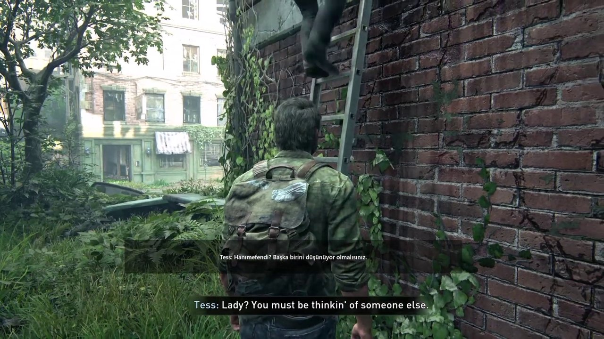
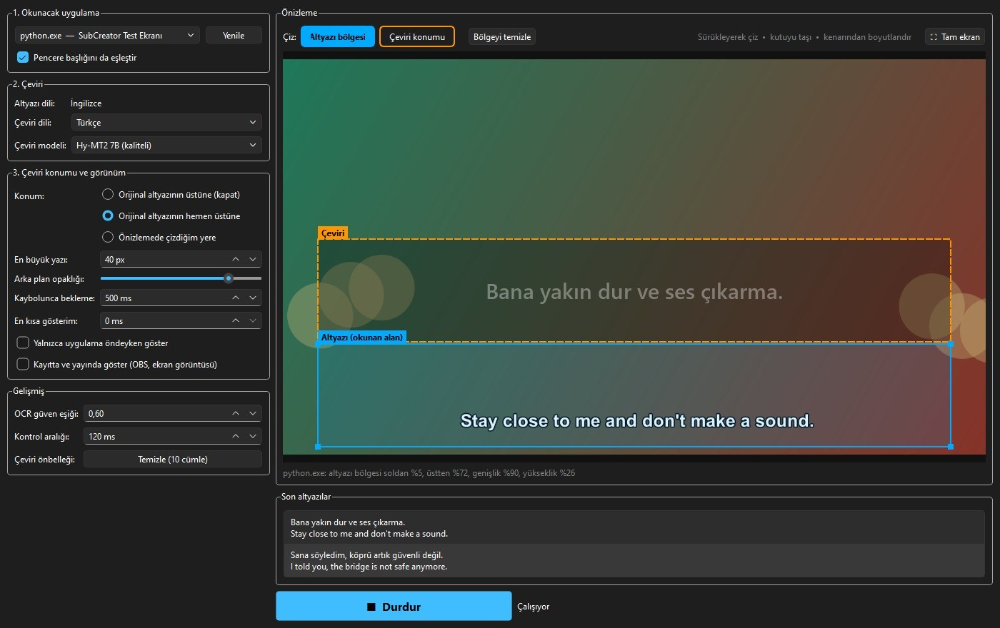

# SubCreator

Oyunlardaki İngilizce altyazıları ekrandan okur, anında Türkçeye çevirir ve altyazının üstünde gösterir. PS5'i Remote Play ile bilgisayarda oynarken (ör. [chiaki-ng](https://github.com/streetpea/chiaki-ng)) ya da İngilizce altyazılı herhangi bir Windows uygulamasında çalışır.

Çeviri, bu bilgisayarın ekran kartında çalışan bir yapay zeka modeliyle ([Tencent Hy-MT2](https://github.com/Tencent-Hunyuan/Hy-MT2)) yapılır. Model bir kez indirilir; sonrasında internet gerekmez ve okunan altyazılar hiçbir yere gönderilmez.



## Kurulum

1. [Releases](https://github.com/tahiruzunkaya/SubCreator/releases/latest) sayfasından `SubCreator-<sürüm>-windows-x64.zip` dosyasını indir.
2. Zip'e sağ tıkla, **Tümünü ayıkla** de ve istediğin bir klasöre çıkar. Programı zip'in içinden çalıştırma.
3. Klasördeki `SubCreator.exe`'yi çalıştır.
   - Windows "Windows kişisel bilgisayarınızı korudu" uyarısı gösterirse **Ek bilgi**'ye, ardından **Yine de çalıştır**'a tıkla. Program imzalı olmadığı için bu uyarı çıkar.
4. İlk açılışta **çeviri modelini indir** penceresi açılır. SubCreator ekran kartına bakıp uygun modeli önerir:

   | Model | İndirme | Ne zaman |
   |---|---|---|
   | Hy-MT2 7B (kaliteli) | 4,6 GB | En az 8 GB belleği olan ekran kartı (ör. RTX 3060 12 GB, RTX 4060 Ti, RX 6700 XT ve üstü) |
   | Hy-MT2 1.8B (hızlı) | 1,9 GB | Daha az belleği olan veya dahili ekran kartları |

   **İndir**'e bas. İndirme yarıda kalırsa bir sonraki denemede kaldığı yerden devam eder. Dosya doğrulandıktan sonra kullanılır.

Model indirilmeden çeviri yapılamaz. Pencereyi kapatırsan model listesinden (Ayarlar → **Çeviri modeli**) daha sonra indirebilirsin.

### Sistem gereksinimleri
- Windows 10 (2004 veya sonrası) ya da Windows 11, 64 bit
- Vulkan destekleyen bir ekran kartı ve güncel sürücüsü (son yıllardaki NVIDIA, AMD ve Intel kartların neredeyse hepsi). CUDA kurmak gerekmez.
- Diskte yaklaşık 450 MB program, ayrıca 1,9 ya da 4,6 GB model için boş alan
- Yalnızca modeli indirirken internet

### Güncelleme ve kaldırma
- **Güncelleme:** Yeni sürümün zip'ini indirip eski klasörün yerine çıkar. Ayarların ve indirdiğin model korunur, yeniden indirmen gerekmez.
- **Kaldırma:** Program klasörünü sil. Ayarları ve modeli de silmek için `%APPDATA%\SubCreator` ve `%LOCALAPPDATA%\SubCreator` klasörlerini sil (Başlat'a bu yolları yazıp Enter'a basarak açabilirsin).

## Kullanım



1. **1. Okunacak uygulama:** Listeden pencereyi seç (ör. `chiaki.exe — chiaki-ng`). Liste güncel değilse **Yenile**'ye bas. Sağdaki **Önizleme**'de uygulamanın tamamı canlı olarak görünür. Ayar penceresi uygulamanın önünde olsa bile önizleme doğru görüntüyü gösterir.
2. **Önizlemede çiz:**
   - **Altyazı bölgesi** (mavi): Altyazının çıktığı alanı sürükleyerek çiz. Yalnızca burası okunur.
   - **Çeviri konumu** (turuncu): Çevirinin ekranda nerede görüneceğini çiz. Çizmezsen çeviri orijinal altyazının üstüne konur. Bunu soldaki **Konum** seçeneklerinden de değiştirebilirsin.
   - Kutuları içinden tutup taşıyabilir, kenar ve köşelerinden boyutlandırabilirsin. Turuncu kutu, son çeviriyle birlikte gerçekte nasıl görüneceğini gösterir.
   - Daha hassas seçim için **⛶ Tam ekran** düğmesine bas, **F11**'e bas veya önizlemeye çift tıkla. Tam ekranda da aynı şekilde çizebilirsin. **Esc**, F11 veya çift tık tam ekrandan çıkarır.
3. **▶ Başlat**'a bas ve oyna. Çeviriler, ekranda gösterilmenin yanında **Son altyazılar** listesinde de görünür.

Her uygulamanın altyazı bölgesi ve çeviri konumu ayrı kaydedilir. Başka bir uygulamaya geçip geri döndüğünde hatırlanır.

Pencereyi kapatınca uygulama görev çubuğu tepsisinde (mavi **TR** simgesi) çalışmaya devam eder. Tepsi simgesinin menüsünden ayarları açabilir, çeviriyi başlatıp durdurabilir veya çıkabilirsin.

SubCreator aynı anda yalnızca bir kez çalışır. Zaten açıkken yeniden başlatırsan, açık olanın penceresi öne gelir.

### Ayarlar penceresi
- **Çeviri:** Çeviri dili (varsayılan Türkçe) ve çeviri modeli. Listede indirilmemiş modeller "– indir" diye görünür; seçince indirme penceresi açılır.
- **Çeviri konumu ve görünüm:** Orijinalin üstüne (kapat), hemen üstüne veya önizlemede çizilen yere; yazı boyutu, arka plan opaklığı, yalnızca uygulama öndeyken gösterme.
- **Ekranda kalış süresi:**
  - **Kaybolunca bekleme** (varsayılan 500 ms): Orijinal altyazı kalktıktan sonra çeviri bu kadar daha görünür.
  - **En kısa gösterim** (varsayılan 0 ms): Her çeviri, orijinal daha erken kalksa bile en az bu kadar görünür.
  - Yeni bir çeviri gelirse beklemeden eskisinin yerini alır.
- **Gelişmiş:** OCR güven eşiği, ekranın kontrol edilme aralığı, çeviri önbelleğini temizleme.

### Çeviri modeli (Hy-MT2)
- Model, Tencent'in açık kaynaklı çeviri modeli [Hy-MT2](https://github.com/Tencent-Hunyuan/Hy-MT2)'dir (Apache 2.0). Hugging Face'teki resmi [7B](https://huggingface.co/tencent/Hy-MT2-7B-GGUF) ve [1.8B](https://huggingface.co/tencent/Hy-MT2-1.8B-GGUF) dosyalarından indirilir ve SHA-256 ile doğrulanır.
- Modeller `%LOCALAPPDATA%\SubCreator\models` klasöründe tutulur.
- Programla gelen [llama.cpp](https://github.com/ggml-org/llama.cpp) `llama-server` ile, yalnızca bu bilgisayarın içinden (127.0.0.1) erişilen gizli bir arka plan süreci olarak çalışır. Birden fazla ekran kartı varsa harici kart (NVIDIA/AMD) seçilir.
- SubCreator açılınca model birkaç saniyede yüklenir ve kapanana kadar ekran kartı belleğinde kalır (7B için yaklaşık 5 GB, 1.8B için yaklaşık 2 GB). SubCreator kapanınca (çökse bile) model de kapanır.
- RTX 5080'de bir altyazının çevirisi 7B ile yaklaşık 100–350 ms, 1.8B ile 50–200 ms sürer.
- Sorun olursa ayrıntılar `%APPDATA%\SubCreator\llama-server.log` ve `subcreator.log` dosyalarında.

### OBS ile kayıt / yayın
Varsayılan olarak çeviri ekran yakalamaya kapalıdır: OBS, ekran görüntüleri ve Discord ekran paylaşımı çeviriyi görmez. Bunun sebebi, programın altyazıyı okurken kendi Türkçe yazısını okumamasıdır.

Kayıtta görünmesi için ayarlarda **Kayıtta ve yayında göster (OBS, ekran görüntüsü)** seçeneğini aç:
- Altyazı bu modda doğrudan uygulamanın pencere içeriğinden okunur, ekran görüntüsünden okunmaz.
- Uygulama buna izin vermiyorsa ayarlarda turuncu bir uyarı çıkar. Bu durumda çeviri, okunan altyazının hemen üstünde gösterilir.
- OBS'te **Ekran Yakalama** (Display Capture) kaynağını kullan. Yalnızca chiaki-ng'nin **Pencere Yakalama**'sını kullanırsan çeviri ayrı bir pencere olduğu için kayda girmez.

### İpuçları
- chiaki-ng'yi pencereli veya kenarlıksız tam ekran kullan. Gerçek (exclusive) tam ekranda çeviri görünmeyebilir.
- Bölgeyi sadece altyazı satırlarını kapsayacak kadar dar çiz. Hem daha hızlı çalışır, hem de ekrandaki başka yazıları okumaz.
- Aynı programın birden fazla penceresi varsa (ör. tarayıcı) **Pencere başlığını da eşleştir**'i işaretle.

## Komut satırı seçenekleri

| Seçenek | Açıklama |
|---|---|
| `--minimized` | Pencereyi açmadan tepside başlat (bölge kayıtlıysa çeviri otomatik başlar) |
| `--start` | Çeviriyi hemen başlat |
| `--process chiaki.exe --title ... --region x,y,w,h` | Bu oturum için hedef/bölge (kaydedilmez) |
| `--engine local:<model.gguf>` | Bu oturum için çeviri modeli |
| `--mode cover\|above\|custom`, `--always-visible`, `--show-in-recordings`, `--no-save`, `--debug` | Test ve hata ayıklama |

Oturuma özel seçeneklerle açılan kopyalar (ör. `--process`, `--no-save`) tek kopya kuralının dışındadır.

## Bilinen sınırlar

- **Gecikme:** OCR yaklaşık 50–250 ms, çeviri yaklaşık 50–350 ms sürüyor. Daha önce çevrilmiş cümleler, program kapanıp açılsa bile, `%APPDATA%\SubCreator\translations.db` önbelleğinden anında gelir.
- **Çok satırlı altyazılar:**
  - Birden fazla satıra bölünmüş tek cümle birleştirilip bütün olarak çevrilir.
  - Tireli diyalog satırları ("- …") ve konuşmacılı satırlar ("Ellie: …") ayrı ayrı çevrilip ayrı satırlarda gösterilir.
  - Metin bölgenin üst veya alt kenarına değerse durum satırında "bölgeyi büyüt" uyarısı çıkar. Altyazı bölgesini oyundaki en uzun (3 satırlık) altyazıyı kapsayacak şekilde çiz.
- **Çeviri öncesi temizlik:** Sık OCR hataları düzeltilir ("| know" → "I know", "every- thing" → "everything"). Konuşmacı adları ("Ellie: …") çevrilmeden korunur.
- **Orijinali kapatma modu** Windows 10 2004+ gerektirir: çeviri penceresi ekran yakalamadan hariç tutulur, böylece OCR kendi Türkçe yazımızı okumaz. Desteklenmezse otomatik olarak "üstünde göster" moduna geçer.
- Altyazı dili şimdilik yalnızca İngilizce (OCR modeli İngilizce/Çince).
- Önizleme ve uygulama arka plandayken okuma, pencere içeriğini doğrudan almak için PrintWindow kullanır. Bunu desteklemeyen uygulamalarda ekran görüntüsüne düşer. O durumda önizlemede, uygulamanın önündeki pencereler görünebilir.

## Geliştirme

Python 3.12 ve Windows gerekir.

```
python -m venv .venv
.venv\Scripts\python.exe -m pip install -r requirements.txt -r requirements-dev.txt
.venv\Scripts\python.exe -m subcreator          # uygulamayı çalıştır
.venv\Scripts\python.exe scripts\selftest.py     # modül testleri
powershell -ExecutionPolicy Bypass -File build.ps1
```

`build.ps1`, `dist\SubCreator\SubCreator.exe` klasörünü ve Releases'e yüklenecek `dist\SubCreator-<sürüm>-windows-x64.zip` dosyasını üretir. Sürüm numarası `subcreator\__init__.py` içindedir.

Depoda olmayan, elle konması gereken dosyalar (`vendor\`, git'e eklenmez):
- `vendor\llama\`: [llama.cpp sürümleri](https://github.com/ggml-org/llama.cpp/releases) içinden `llama-b12499-bin-win-vulkan-x64.zip` açılmış hali. Lisans dosyaları `LICENSE-llama.cpp.txt` ve `LICENSE-LLVM-OpenMP` adıyla.
- `vendor\models\` (isteğe bağlı): Geliştirirken modeli indirmeden denemek için `.gguf` dosyaları buraya konabilir. Uygulama bu klasöre de bakar.

Model indirme adresleri ve SHA-256 değerleri `subcreator\models.py` dosyasındaki katalogda. Hugging Face'e erişilemeyen ağlarda `SUBCREATOR_MODEL_MIRROR=http://sunucu` ortam değişkeniyle aynı yol yapısındaki bir ayna sunucu kullanılabilir.

PS5 olmadan test için, değişen İngilizce altyazılar gösteren bir pencere:

```
.venv\Scripts\python.exe scripts\demo_window.py --top
```

Sonra SubCreator'da `python.exe — SubCreator Test Ekranı`'nı seçip bölgeyi çiz.

## Lisans

SubCreator [MIT lisansı](LICENSE) ile dağıtılır. Kullanılan üçüncü taraf bileşenler ve lisansları [THIRD_PARTY_NOTICES.txt](THIRD_PARTY_NOTICES.txt) dosyasında.

---

**English:** SubCreator reads English subtitles from any Windows app (e.g. PS5 Remote Play via chiaki-ng) with OCR and overlays a live Turkish translation. Translation runs locally on your GPU with Tencent's Hy-MT2 model through llama.cpp (Vulkan), so it works offline once the model is downloaded on first launch. Download the zip from Releases, extract it and run `SubCreator.exe`.
